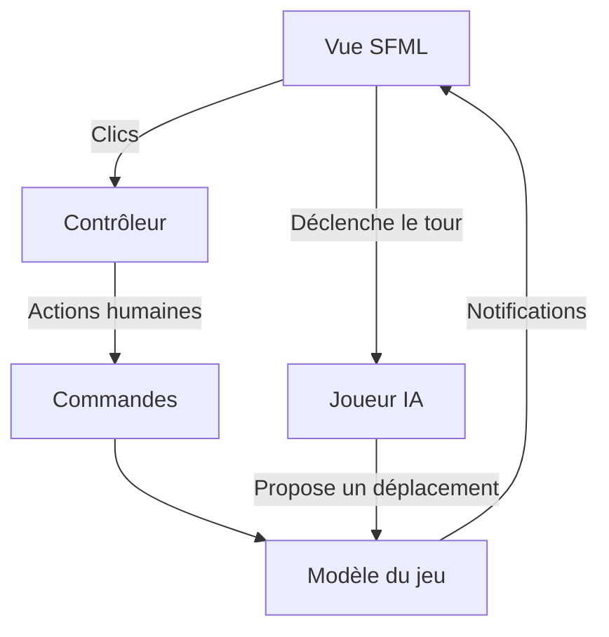

# Yalta Chess — Projet PAA

Jeu d’échecs à trois joueurs développé en C++, avec une interface graphique SFML et des adversaires contrôlés par ordinateur.

Le plateau comporte 96 cases et accueille trois camps : blanc, rouge et noir. Chaque camp commence avec 16 pièces. Les parties se déroulent localement, sur le même ordinateur.

## Fonctionnalités

- Choix entre trois humains, deux humains et une IA, ou un humain et deux IA.
- Sélection et déplacement des pièces à la souris.
- Mise en évidence de la pièce sélectionnée et de ses destinations possibles.
- Déplacements et captures adaptés à la géométrie du plateau.
- Vérification des coups ordinaires pour éviter de laisser son roi en échec.
- Détection de l’échec, du mat et du pat dans le modèle.
- Tentative de roque par sélection du roi puis de sa tour.
- Menu principal et écran de pause.

Le projet reste une implémentation pédagogique. Certaines règles et certains traitements nécessitent encore des corrections ; voir la documentation technique.

## Modes de jeu

| Mode | Blanc — Alice | Rouge — Bob | Noir — Carol |
| --- | --- | --- | --- |
| 0 IA | Humain | Humain | Humain |
| 1 IA | Humain | Humain | IA |
| 2 IA | Humain | IA | IA |

Les noms sont prédéfinis. Le menu ne propose pas de personnalisation des noms ni de réglage de difficulté.

## Organisation

| Élément | Rôle |
| --- | --- |
| main.cpp | Point d’entrée de l’application |
| src/model/ | Plateau, pièces, joueurs, règles et état de la partie |
| src/controller/ | Traduction des clics en actions |
| src/view/ | Affichage et interactions SFML |
| src/command/ | Commandes de déplacement, capture, roque et promotion |
| image/ | Images des pièces des trois camps |
| main.exe | Exécutable Windows fourni dans le dépôt |

## Architecture

## Préparation et lancement

Une version Windows compilée est présente dans le dépôt. Son fonctionnement et ses dépendances doivent être vérifiés sur la machine cible.

1. Récupérer le projet complet.
2. Conserver le dossier image à côté de l’exécutable.
3. Lancer l’application depuis le dossier du projet pour permettre le chargement des images.
4. Choisir le nombre d’IA, puis sélectionner « Commencer la partie ».

Pour reconstruire l’application, un environnement C++ compatible avec les fonctionnalités C++17 utilisées et la bibliothèque SFML correspondant à l’API du projet est nécessaire. Les appels graphiques observés correspondent à l’API SFML 3 ; la version exacte n’est pas déclarée dans un fichier de dépendances.

Le dépôt ne fournit ni projet CMake, ni Makefile, ni procédure de compilation automatisée. Les polices sont recherchées dans le dossier des polices Windows. Des adaptations sont nécessaires pour d’autres systèmes, notamment pour les chemins et la casse des noms de fichiers.

## Intelligence artificielle

Le projet contient une recherche de type minimax paranoïaque avec élagage alpha-bêta : l’IA maximise son score et considère les deux autres camps comme des adversaires qui cherchent à le réduire.

L’évaluation prend en compte les pièces, leur position et les répétitions. Le calcul est lancé en arrière-plan.

La détection actuelle des répétitions interrompt toutefois la recherche dès le premier nœud évalué. Il ne faut donc pas présenter cette version comme une recherche effective à trois niveaux. Les détails figurent dans la documentation technique.

## Limites principales

- Promotion présente dans les classes, mais non reliée au parcours de jeu.
- Absence de bouton d’annulation, de sauvegarde et de chargement.
- Contrôles du roque incomplets.
- Synchronisation entre l’IA et l’interface à renforcer.
- Gestion de la fin de partie et du pat à compléter côté interface.
- Absence de tests automatisés et de configuration de compilation dans le dépôt examiné.

## Documentation

- [Documentation technique](docs/Documentation-technique.md)
- [Guide utilisateur](docs/Guide-utilisateur.md)

Documentation fondée sur la lecture de la branche main, révision 6481d4020568b650da5ba208e68f6c73f311d3d1. L’application n’a pas été compilée ni exécutée lors de cette rédaction.

[Dépôt GitHub](https://github.com/chaiebyassine/projet_paa)

